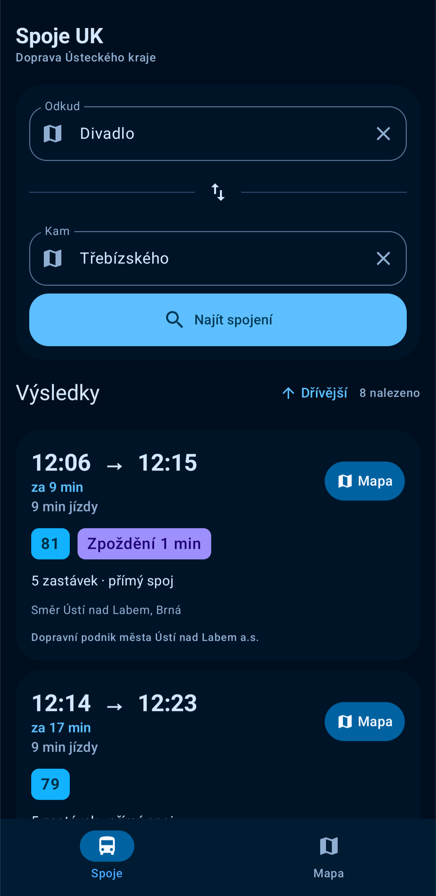
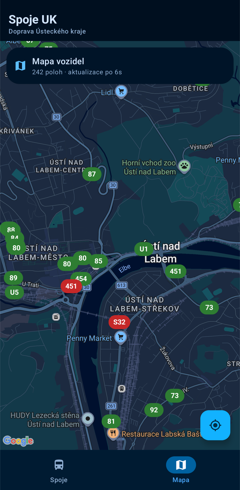
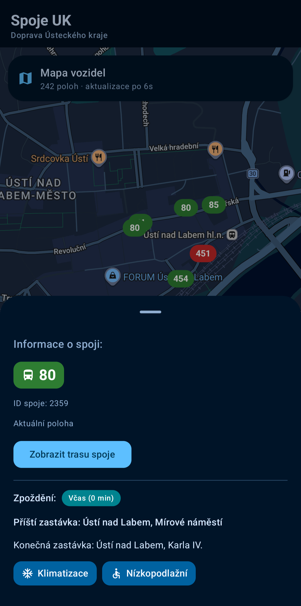
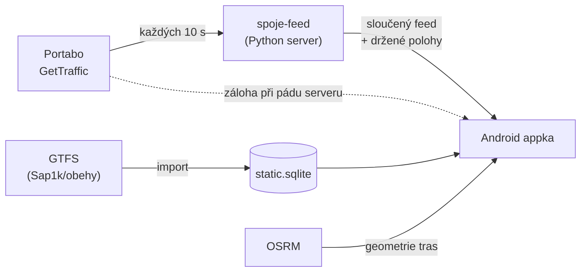

<div align="center">

# 🚌 Spoje UK

**Vyhledávání spojení a živá mapa vozidel pro Dopravu Ústeckého kraje (DÚK)**


Hledání spojů funguje **offline** nad lokální databází jízdních řádů.
Polohy autobusů se zobrazují **živě**, včetně zpoždění, a nemizí, když zdroj dat na chvíli vypadne.


  

</div>

---

## ✨ Funkce

### 🔎 Vyhledávání spojení
- Vlastní vyhledávač **RAPTOR** nad lokální SQLite databází, bez serveru a bez internetu
- Přímé spoje i **přestupy**, s minimální dobou přestupu a **pěšími přesuny** mezi zastávkami do 250 m
- Načítání **dřívějších** (tlačítko) i **pozdějších** spojů (automaticky při posunu seznamu) a pull-to-refresh
- Zpoždění z živých dat přímo u výsledku hledání
- Zobrazení spoje na mapě jedním klepnutím

### 🧠 Chytré napovídání zastávek
- Řazení: **1. podle používání → 2. podle vzdálenosti od tebe → 3. zbytek**, takže „Divadlo" najdeš nejdřív v Ústí, ne v Teplicích
- **Předvyplnění odkud / kam** při startu: appka si pamatuje, kam jsi jel naposledy, a podle polohy navrhne poslední jízdu z nejbližší zastávky
- Tlačítko **✕** pro odebrání zastávky ze seznamu často používaných
- Tlačítko **Moje poloha** najde nejbližší zastávku (vzdálenost po silnici)
- Historie se ukládá **jen v zařízení**

### 🗺️ Živá mapa vozidel
- Polohy autobusů na mapě Google, označené číslem linky; **červeně** při zpoždění nad 3 minuty
- Detail vozidla: zpoždění, dopravce, **příští a konečná zastávka**, klimatizace, nízkopodlažnost
- **Stáří polohy** u každého vozidla („Aktuální poloha" / „Poloha stará 2 min 10 s")
- **Celá trasa spoje po silnicích** po klepnutí na vozidlo
- Upozornění, když zdroj dat nedodává víc než 18 vozidel najednou

---

## 🏗️ Architektura



| Vrstva | Co dělá |
|---|---|
| `DukApi` | Fasáda: načtení jízdních řádů, hledání, polohy, trasy |
| `Timetable` | Zastávky, spoje, kalendář provozu, párování vozidel se spoji |
| `Net` / `Planner` | RAPTOR, sestavení spojení, stránkování po časových oknech |
| `GtfsImporter` | Převod GTFS → kompaktní SQLite (časy jako BLOB) |
| `RealtimeClient` | Stahování poloh, filtrování nesmyslných záznamů, držení posledních poloh |
| `OsrmClient` | Trasy po silnicích, vzdálenosti po silnici, cache na disku |
| `TripHistory` | Poslední jízdy pro předvyplnění |
| `spoje-feed` | Volitelný server, který drží poslední polohy vozidel, když zdroj vypadne |

### Proč vlastní server?
Zdroj poloh občas **na desítky sekund až minuty vynechá vozidla**, hlavně MHD. Mobilní appka přitom neběží celý den, takže si výpadek nemá jak pamatovat. Malý server na VPS stahuje feed každých 10 s a vrací ho ve stejném formátu, jen vozidla, která zmizela, dál drží s poslední známou polohou (**MHD až 5 min, ostatní 3 min**) a u každého vozidla posílá stáří polohy. Appka tak ukáže nejaktuálnější možná data hned po otevření.

Když server nejde, appka se **automaticky přepne přímo na zdroj**.

---

## 📡 Zdroje dat

| Data | Zdroj | Poznámka |
|---|---|---|
| Polohy a zpoždění | `tabule.portabo.cz` (GetTraffic) | Veřejný, **neoficiální**, bez podmínek použití, může se změnit |
| Jízdní řády | GTFS sestavené projektem [Sap1k/obehy](https://github.com/Sap1k/obehy) z dat CIS JŘ | Závislost na cizím buildu, viz plány |
| Trasy po silnicích | [OSRM](https://project-osrm.org/) (veřejné demo) a data OpenStreetMap | Profil pro auto, ne pro autobus; nezná skutečné objížďky dopravce |
| Mapa | Google Maps | Potřebuje API klíč |

> ⚠️ **Neoficiální projekt.** Aplikace nemá žádnou spojitost s Dopravou Ústeckého kraje, DPmÚL, CHAPS ani Ministerstvem dopravy. Data mohou být neúplná nebo zpožděná, na kritické cesty se spoléhej na oficiální zdroje.

---

## 🚀 Spuštění

### Android appka

1. Otevři projekt v **Android Studiu**
2. Doplň svůj **Google Maps API klíč** (`com.google.android.geo.API_KEY` v `AndroidManifest.xml`) a klíč **nikdy necommituj**
3. Nastav `FEED_URL` na svůj server, nebo ho nech prázdný a appka použije přímo zdroj poloh
4. Pro offline start přibal databázi jízdních řádů jako `app/src/main/assets/static.sqlite`. Pokud chybí, stáhne se při prvním spuštění z GitHub release

### Server `spoje-feed` (volitelné)

Stačí Python 3, bez dalších balíčků.

```bash
sudo mkdir -p /opt/spoje-feed
sudo cp server.py /opt/spoje-feed/
sudo cp spoje-feed.service /etc/systemd/system/
sudo systemctl daemon-reload
sudo systemctl enable --now spoje-feed

curl -s http://127.0.0.1:8787/health
```

| Proměnná | Výchozí | Význam |
|---|---|---|
| `POLL_S` | `10` | Jak často stahovat zdroj (s) |
| `HOLD_MHD_S` | `300` | Jak dlouho držet zmizelé MHD (s) |
| `HOLD_OTHER_S` | `180` | Jak dlouho držet ostatní vozidla (s) |
| `BIND` | `127.0.0.1` | Adresa poslechu |
| `PORT` | `8787` | Port |
| `STATE_FILE` | `/var/lib/spoje-feed/state.json` | Uložený stav přežije restart |

Endpointy: `GET /traffic` (sloučený feed) a `GET /health` (stav).

> 🔒 Android od API 28 blokuje nešifrované HTTP. Pro veřejné použití dej před server reverzní proxy s HTTPS (např. Caddy), jinak povol HTTP jen pro svou adresu přes `network_security_config`.

---

## 🛠️ Technologie

Kotlin · Jetpack Compose · Material 3 (Expressive) · Coroutines · OkHttp · SQLite · Google Maps Compose · Fused Location · OSRM · Python (server)

---

## 🗺️ Plány

- [ ] Vlastní import oficiálních dat **CIS JŘ (JDF)** místo cizího GTFS buildu
- [ ] Trasy **předpočítané při buildu** (vlastní OSRM / Valhalla) a uložené v databázi, bez dotazů na veřejný server
- [ ] Automatická aktualizace jízdních řádů
- [ ] HTTPS pro feed server a rate limit
- [ ] Odjezdy ze zastávky
- [ ] Hledání podle poloh vozidel i s ohledem na objížďky (živá stopa vozidla přes plánovanou trasu)

---

## 📄 Licence a poděkování

Licence: *doplň (např. MIT)*

Díky patří projektu [obehy.cz / Sap1k](https://github.com/Sap1k/obehy) za zpracování jízdních řádů, přispěvatelům [OpenStreetMap](https://www.openstreetmap.org/copyright) a otevřeným datům CIS JŘ.
